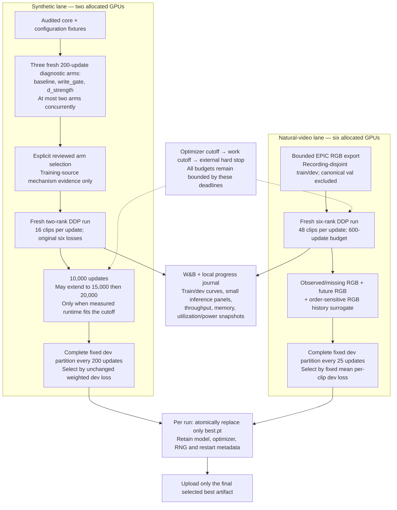
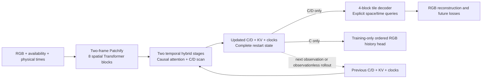

# Diagnostic and natural-video training flows

These runs use the existing hybrid C/D + KV architecture in independent model instances. They do not alter the core state contract or overwrite the original pilot. The diagram describes training and selection, not a new backbone.

The short diagnostic arms each retain their best **training-source history-MSE** checkpoint; that selection is not validation. The later two-GPU run and the natural-video trial select by their own complete fixed dev partitions. An interrupted dev pass does not select a checkpoint. The retained best step may precede the final optimizer step. Runtime-only budget extensions never inspect loss or quality.

Each training run instantiates this same model structure, with its own weights and recurrent state:

KV participates in temporal updates and restart; the image decoder reads only C/D. Spatial BF16 does not change the FP32 C/D carries and decoder; KV retains its BF16 cache contract. This diagram shows the shared backbone and history head. The synthetic objective also uses a semantic projection for invariance and noncollapse, omitted here; the natural trial has no such projection head. A selected synthetic intervention changes only its declared write initialization or D modulation strength; the natural trial uses the default architecture and initialization policy specified in its protocol.

Neither objective guarantees C/D disentanglement. Improved history fitting, a larger D-swap prediction change, or lower natural-video reconstruction error does not alone demonstrate event semantics in C or configuration uniquely stored in D. The natural history target is an RGB-order surrogate, and no synthetic C/D labels are invented for natural clips. These runs do not use held-out results for tuning.

Detailed frozen protocols: [C/D diagnostics and subsequent two-GPU run](../cd_diagnostic.md), [natural-video trial](../natural_video_trial.md). See also the [hybrid training architecture](mavt-hybrid-training.md) for the original pilot flow.
