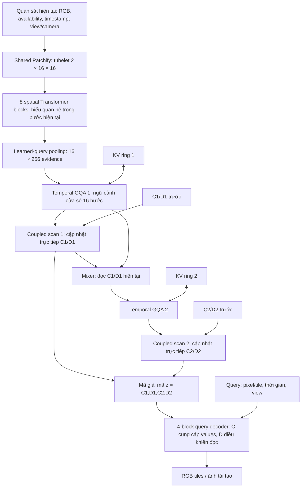
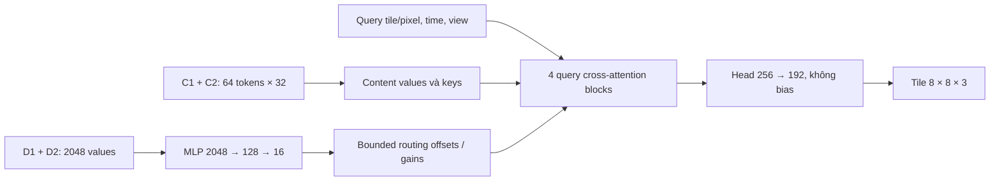

# MAVT hiện tại: ý tưởng, flow, I/O và vai trò từng khối

Cập nhật **17/10/2026**. Bản giải thích đối chiếu implementation tại
`493a6a3c4b0a3220f4d349529dcf510aec916000`: **hybrid state v2 + hướng B của loss v3**.
Các kích thước dưới đây là preset đầy đủ, không phải `tiny` dùng trong test.
Tài liệu mô tả kiến trúc đã có và mục tiêu học; không coi mục tiêu là kết quả đã đạt.

[Preset](../../configs/mavt4d/hybrid_cd2_kv_v2.json) ·
[API](../reference_hybrid_cd_model.md) ·
[Thiết kế chi tiết](../plans/mavt-hybrid-v2-design.md) ·
[Loss v3](../plans/mavt-cd-loss-v3.md)

## 1. Ý tưởng MAVT đang theo đuổi

MAVT đọc các quan sát nối tiếp, cập nhật một biểu diễn nhỏ của event, rồi dùng
biểu diễn đó để tái tạo hình ảnh, đọc phần thiếu và dự báo khi chưa có quan sát mới.
Mục tiêu là một **unified visual tokenizer có memory**, trong đó mã đọc ra được
cũng trực tiếp tham gia cập nhật recurrent.

Hai phần của mã có vai trò dự kiến:

- **C — lõi event và nội dung cần giữ:** bằng chứng về chuyện gì đã diễn ra,
  thứ tự/hướng diễn biến, cùng visual content cần để dựng ảnh. C không chỉ là
  background ổn định, cũng không chỉ là nhãn phân loại.
- **D — configuration tương đối với lõi đó:** cách event được thể hiện ở thời
  điểm đang xét, như bố trí hoặc biên độ hình học. D không bị giới hạn thành
  hiệu giữa frame trước và frame sau; D được phép chứa thông tin thời gian.

Ví dụ, hai video có cùng hình ảnh cuối nhưng đi đến đó theo hai lịch sử khác
nhau phải có C phân biệt được lịch sử. Ngược lại, hai biến thể cùng event nhưng
có configuration `compact` và `wide` cần C gần nhau và D giúp decoder dựng đúng
biến thể. Đây là những quan hệ được kiểm bằng loss và benchmark.

“C bất biến” ở đây là **tương đối với thay đổi configuration khi bằng chứng
event tương đương**. C vẫn phải cập nhật khi quan sát mới bổ sung hoặc sửa hiểu
biết về event. Không ép C giống nhau ở mọi frame của một video.

## 2. Flow tổng thể

Các mũi tên KV biểu diễn đọc cache và ghi K/V mới. K/V được chiếu từ **input đã
normalize của GQA tương ứng**, không phải từ output của chính GQA đó.

**Backbone hiện tại** gồm observer không gian và hai temporal stages:
Patchify → spatial Transformer → pooling → GQA/scan → mixer → GQA/scan.
Decoder là phần đọc biểu diễn ra ảnh; loss là tín hiệu huấn luyện quanh pipeline.
Khối spatial không giữ memory qua bước; C/D và KV giữ memory qua bước.

## 3. I/O toàn hệ thống

Gọi `B` là số stream, `V` số view, `F` số frame trong một bước, `H,W` là kích
thước ảnh. **Một bước vật lý của video chứa tối đa hai frame**; nó khác với một
optimizer step của trainer.

**Input của trial synthetic hiện tại** là 12 frame `128×192`, một camera cho
mỗi clip, tức sáu bước vật lý. Ở mỗi bước, Patchify tạo `8×12 = 96` patch tokens
width 384, rồi pooling thành `16×256`. Render một frame kích thước này cần
`16×24 = 384` tile queries. Ví dụ `256×256` ở bảng dưới minh họa cách scale
không gian của cùng kiến trúc, không phải độ phân giải đang dùng trong trial.

| Giao diện | Input | Output / ý nghĩa |
|---|---|---|
| Quan sát một stream | RGB `[V,F,3,H,W]`, availability `[V,F,H,W]`, timestamp FP64 `[V,F]`; view identity và camera geometry nếu có | `ObservationStep`; RGB của trial dùng miền `[-1,1]` |
| `model.step(S_prev, observation)` | Complete state trước và quan sát vừa tới; batch truyền một observation mỗi stream | Complete state mới `S_t` |
| `forward_sequence(S0, steps)` | Chuỗi các bước vật lý, cùng cách ghép tubelet như streaming | Một state cho mỗi bước; hỗ trợ sequential hoặc associative |
| `decode(z_t, query)` | C/D và timestamp đọc ra; query image-pixel/time/view | RGB `[B,Q,3]` cho `Q` pixel queries |
| Tile/render API | Cùng mã C/D, các query tile trên lưới ảnh | Mỗi tile chứa `8×8×3`; ghép thành ảnh theo kích thước yêu cầu |
| `rollout(S_t, end_times)` | Complete state và các mốc thời gian tương lai FP64 `[T,B]`, không có RGB tương lai | State dự báo để decode tại các mốc đó |

Ảnh đơn dùng một frame thật và padding có validity. Triplane có plane identity,
không được diễn giải ba plane thành ba thời điểm. Front-end có đường nhận các
dạng này; world-coordinate/triplane readout còn cần adapter riêng. Trial loss v3
hiện kiểm trên synthetic video RGB, chưa chứng minh chất lượng cho mọi modality.

## 4. Từng khối làm gì?

| Khối | Input → output trong preset | Mục đích |
|---|---|---|
| Availability + metadata | RGB, mask, thời gian/view → quan sát hợp lệ và coverage | Phân biệt pixel không quan sát được với pixel đen; ngăn hidden RGB lọt vào model |
| **Shared Patchify** | Conv3d kernel/stride `2×16×16`, width 384; một view `256×256` → `256×384` tokens | Biến vùng ảnh nhỏ qua hai frame thành cùng loại visual tokens |
| **Spatial Transformer** | 8 blocks, width 384, 6 heads; giữ lưới patch | Kết hợp chi tiết cục bộ với quan hệ toàn cảnh trong cùng bước |
| **Summary pooling** | Patch/view tokens → `16×256` | Tạo một tập evidence nhỏ, kích thước cố định để temporal path xử lý |
| **GQA 1** | Evidence và KV1 → `16×256` contextual tokens | Đối chiếu quan sát hiện tại với ngữ cảnh gần đây |
| **Coupled C/D scan 1** | Context, elapsed time, C1/D1 trước → C1/D1 mới, mỗi bank `32×32` | Tích lũy bằng chứng và biến đổi vào state trực tiếp |
| **Stage mixer** | Context stage 1 và C1/D1 mới → `16×256` | Cho tầng sau đọc biểu diễn vừa được cập nhật của tầng trước |
| **GQA 2 + scan 2** | Mixer output, KV2, C2/D2 trước → C2/D2 mới | Thêm một tầng temporal reasoning được điều kiện hóa bởi state stage 1 |
| **Query decoder** | C1/C2, D1/D2 và query → RGB tiles/pixels | Dựng nội dung từ C, với D điều khiển cách truy xuất và gain |

### Patchify và spatial attention

Availability được áp **trước Conv3d**. Hidden RGB, kể cả NaN tại vùng không
quan sát, không được làm đổi feature. Coverage/validity được giữ riêng, nên
“không có dữ liệu” không bị đồng nhất với “ảnh có giá trị bằng 0”.

Trong tám Transformer blocks, **block 4 và 8 là global attention trong bước**;
sáu block còn lại dùng local window `8×8`, shift `0/4` luân phiên, không nối
vòng hai mép ảnh. Local attention không vượt view; global blocks có thể trao đổi
patch/view trong cùng bước. Không có attention tới bước tương lai ở phần này.

Pooling dùng 16 learned queries cố định đọc patch tokens. Các queries là tham
số dùng chung của model, không phải 16 memory slots được mang từ frame trước.
State chỉ khả dụng khi frame cuối của tubelet đã tới: causal ở biên tubelet,
không phải một state riêng sau frame đầu của tubelet hai frame.

### Temporal attention và KV cache

Mỗi GQA có **8 query heads, 2 KV heads**, head dimension 32. Nó nhìn tối đa
**16 accepted steps gồm bước hiện tại**, với 16 summary tokens mỗi bước.
Các summary tokens cùng bước nhìn nhau; causal mask áp giữa các bước.

KV là bộ đệm features để attention truy xuất ngữ cảnh. C/D là các biến recurrent
được cập nhật qua thời gian và đưa cho decoder. Hai cơ chế bổ sung cho nhau:
KV cho đường truy xuất trực tiếp trong cửa sổ; C/D có thể tích lũy thông tin qua
nhiều cửa sổ. Khả năng giữ thông tin lâu đến đâu vẫn phải đo.

Spatial windows và temporal window tạo cấu trúc attention giới hạn phạm vi.
Đây không phải object-graph sparse attention, và reference chưa phải sparse
kernel tối ưu về throughput.

### CD-Split và cập nhật state trực tiếp

Trong đường hybrid hiện tại, vai trò “CD-Split” nằm ở **paired write + coupled
C/D cell**, thay cho cách chỉ tách hai vector sau encoder rồi mới nén.
Mỗi scan dùng 32 paired write queries đọc context và sinh hệ số cập nhật cho
1024 cặp tọa độ C/D. Với mỗi cặp:

\[
\begin{bmatrix}c_t\\d_t\end{bmatrix}
=
\underbrace{\begin{bmatrix}a_{CC}&a_{CD}\\a_{DC}&a_{DD}\end{bmatrix}_t}_{A_t}
\begin{bmatrix}c_{t-1}\\d_{t-1}\end{bmatrix}
+\begin{bmatrix}b_C\\b_D\end{bmatrix}_t.
\]

`a_CD` đưa D trước vào C mới, để C có đường tiếp nhận biến đổi đã tích lũy.
`a_DC` đưa C trước vào D mới, để biến đổi có thể phụ thuộc lõi đang giữ.
Hai entries còn lại giữ/biến đổi state của từng nhánh; `b_C,b_D` ghi evidence mới.
Gate và norm bound điều tiết lượng ghi/khuếch đại. Chúng không tự bảo đảm nhớ
dài hoặc phân rã đúng semantics.

Cell cũng không áp một luật cứng rằng C luôn cập nhật chậm hơn D. Sự phân vai
event/configuration đến từ mục tiêu học và cách decoder sử dụng hai bank.

Output affine FP32 chính là carry C/D mới. Đường này không có bước VAE hay
quantizer để tạo một mã khác với recurrent state. Preset hiện dùng mã liên tục;
chưa phải discrete codebook hay bitstream đã được lượng hóa.

Stage 1 cập nhật trước; mixer đọc C1/D1 mới để xây input stage 2. Không có
feedback stage 2 → stage 1. Chỉ riêng việc có hai tầng chưa cho phép gọi tầng
1 là “low-level” và tầng 2 là “semantic”; đó là cách diễn giải cần bằng chứng.

### Vì sao còn giữ được parallel scan?

Hệ số `A_t,b_t` được tính từ evidence/context và thời gian, **không phụ thuộc
state trước của chính scan đó**. Vì vậy hai cập nhật affine hợp thành được:

\[
(A_2,b_2)\circ(A_1,b_1)=(A_2A_1,\;A_2b_1+b_2).
\]

Phép hợp có tính kết hợp, nên tính prefix bằng parallel scan được. D→C feedback
nằm trong ma trận `A_t`, không bắt buộc biến gate thành hàm phi tuyến của carry.
Nếu thêm gate/MLP đọc carry cũ trên đường update, tính chất này phải được xét lại.

Full sequence chạy **GQA1 → scan1 → mixer → GQA2 → scan2**, song song theo từng
layer. Toàn mạng không phải một joint scan duy nhất. Khi inference streaming,
cell vẫn cập nhật từng bước. Đây là hybrid attention + coupled affine scans của
MAVT, không phải implementation stock Mamba/Jamba, không có MoE. Chưa có bằng
chứng tốc độ thắng GRU/Mamba chỉ từ việc công thức scan đúng.

## 5. Decoder: C cung cấp nội dung, D điều khiển cách dựng

Decoder nhận **C/D của cả hai stage** và explicit query; không đọc RGB input,
spatial skip features hoặc KV trực tiếp.

Các block dùng query để đọc C. D được nén thành **16 modulation values dùng
chung cho một code**, rồi điều khiển routing/gain. Query ảnh hưởng phép đọc,
nhưng hiện chưa có một phép `Read(query,D)` riêng để lấy modulation khác nhau
cho mỗi vị trí. Đó là phương án decoder còn nằm trong ablation kế tiếp.

Các phép chiếu content và RGB liên quan không có bias, giữ tính chất
**`C = 0 ⇒ RGB = 0` bất kể D**. Ràng buộc này chặn D tự phát ra ảnh khi không
có content từ C. Nó không chứng minh D đã được dùng hiệu quả, hoặc D không thể
mã hóa thông tin event qua routing/gain.

Một ảnh `256×256` cần `32×32 = 1024` tile queries. Mỗi tile query sinh 192 số
RGB; ghép tile và crop biên cho ra ảnh. Pixel queries lấy pixel tương ứng từ
tile đã căn lưới. Các query chunks độc lập, decoder không giữ cache qua lần gọi.

## 6. Mã giải mã và complete state khác nhau thế nào?

\[
z_t=(C_t^{(1)},D_t^{(1)},C_t^{(2)},D_t^{(2)}),
\qquad S_t=(z_t,KV_t^{(1)},KV_t^{(2)},\text{clock/validity/cursors}).
\]

| Dữ liệu mỗi stream | Shape / dung lượng tensor | Dùng làm gì? |
|---|---|---|
| C | `[2,32,32]`, FP32; 8 KiB | Content/event state của hai scan |
| D | `[2,32,32]`, FP32; 8 KiB | Configuration state của hai scan |
| K và V | Mỗi tensor `[2,16,16,2,32]`, BF16; tổng 128 KiB | Hai temporal cache hữu hạn |
| Clock, step IDs, validity, cursors | 800 byte | Tiếp tục đúng thời gian và đúng logical window |
| Tổng complete state | **148.256 byte ≈ 144,8 KiB** | Memory tensor của một stream |

Header identity chung thêm 68 byte. Các số này không gồm model weights,
serialization overhead, workspace hay autograd activations. State nhỏ không
đồng nghĩa train ít VRAM: train còn giữ computation graphs của nhiều bước,
samples và các lần decode trong loss.

`CDCode` chứa z và readout timestamp, đủ để decode. `HybridCDKVState` chứa S,
cần để tiếp tục stream chính xác. Với cùng model weights, hai complete states
có cùng `CDCode` (C/D và readout timestamp) nhưng khác KV cho ảnh decode giống
nhau nếu query giống nhau, nhưng có thể cập nhật khác nhau khi quan sát kế tiếp tới.

Không reset state ở chunk boundary. Truyền state cuối chunk sang chunk sau;
TBPTT detach C/D và KV chỉ cắt gradient, không xóa giá trị memory.

**Training checkpoint là một lớp khác:** `last.pt` giữ model weights, optimizer,
RNG và global step/exposure để resume train. `best.pt` dùng chọn model; chỉ best
được upload W&B trong runner v3. Chúng không làm optimizer/RNG trở thành một
phần của scene-state tại inference.

## 7. Train với vùng thiếu và inference khi bị che

Anisotropic masking tạo những vùng thiếu có cấu trúc theo không gian/thời gian,
thay vì chỉ xóa pixel độc lập. Trial dùng năm family: `clean`, `wide`, `tube`,
`snapshot`, `never_seen`, mỗi family xác suất 20% ở train. Mask được dùng chung
giữa tám biến thể của một source. Target RGB đầy đủ chỉ đi vào loss.

| Mask family | Cấu trúc đang dùng trong trial |
|---|---|
| `clean` | Không che |
| `wide` | Vùng chữ nhật `H/2 × W/2`, kéo dài 1–2 tubelet |
| `tube` | Vùng `H/2 × W/4`, từ frame 4 đến cuối clip |
| `snapshot` | Che toàn ảnh ở các frame 4–7 |
| `never_seen` | Vùng `H/2 × W/2` bị che ở mọi frame |

Các frame indices ở đây bắt đầu từ 0. Đây là mask nhân tạo phục vụ bài toán
thiếu quan sát, không phải segmentation của occluder tự nhiên.

| Tình huống | Pipeline xử lý |
|---|---|
| Thiếu một phần frame, biết availability | Mask hidden RGB trước Patchify; encode phần quan sát được, cập nhật S rồi decode query mong muốn từ C/D |
| Toàn bước thiếu, thời gian tăng | Bypass observer/GQA/mixer; cùng C/D cell chạy missing operator với write bias bằng 0; ghi KV slot không hợp lệ để cửa sổ tiếp tục già đi |
| Toàn bước thiếu, thời gian không đổi | No-op toàn state, không tự tăng cursor hoặc tạo evidence |
| Có vật thể che khuất tự nhiên trong ảnh | Bề mặt vật che vẫn là RGB quan sát hợp lệ. Model không tự có oracle mask của vật bị che |
| Chưa có frame tương lai | Rollout bằng các mốc thời gian đã yêu cầu rồi decode; không chỉ gắn timestamp tương lai vào query của state cũ |

Missing dynamics dùng operator affine phụ thuộc elapsed time với write bias 0,
không có predictor/updater giữ hidden state riêng. Vùng đã từng thấy có thể
được đọc lại nếu evidence còn được giữ trong state. Vùng chưa từng thấy hoặc
mọi dấu hiệu phân biệt event đều bị che thì không có căn cứ bảo đảm khôi phục
đúng; RGB decoder hiện không xuất phân phối uncertainty đã được hiệu chuẩn.

Các camera views đã tới có thể cùng đóng góp evidence trong bước. Tuy nhiên
việc hỗ trợ input nhiều view không đồng nghĩa đã chứng minh novel-view completion
hoặc hình học 3D chính xác. Masked synthetic RGB cũng chưa thay thế benchmark
occlusion tự nhiên.

## 8. Loss v3 buộc C/D nhận đúng vai trò bằng cách nào?

Hướng **B** giữ backbone và decoder trên; thay objective. Trong path v3 này
không còn C-only RGB-history auxiliary head hoặc semantic projection head của
pilot v2. Dataset synthetic có **4 event cores × 2 configurations** mỗi source.
Source/core/config metadata chỉ dùng để tạo cặp ở phía loss, không đưa vào model.

Bốn core là trái rồi phải (`left_then_right`), phải rồi trái
(`right_then_left`), clockwise và counterclockwise. Trong cùng configuration,
chúng có hai frame cuối giống hệt; các cặp đảo chiều có cùng
tập frame nhưng khác thứ tự. `compact/wide` đổi độ xa/bán kính quỹ đạo. Điều này
tạo một bài kiểm có kiểm soát cho “giữ diễn biến” và “giữ configuration”.

| Loss | Weight | Tín hiệu muốn tạo |
|---|---:|---|
| Observed RGB | 1 | C/D còn đủ thông tin tái tạo phần nhìn thấy |
| Missing RGB | 1 | Học đọc vùng thiếu từ bằng chứng còn lại/lịch sử |
| Future RGB | 0,5 | State còn hữu ích sau observationless rollout |
| Event/order relation trên C | 1 | C phân biệt event/hướng/thứ tự; không chỉ giống nhau vì hình ảnh cuối giống nhau |
| Full-C consistency | 0,1 | C cùng source/event/thời điểm gần nhau khi chỉ đổi compact/wide |
| Reciprocal D-swap | 1 | D phải điều khiển configuration mà decoder dựng ra |
| C variance floor | 0,05 | Chống việc tất cả C co về cùng một mã |

Các RGB losses cân bằng vùng có biến đổi và background để lỗi nền không lấn
át nội dung nhỏ. Target-derived support chỉ là trọng số loss; không đưa vào
encoder hay dùng để tiết lộ vùng target cho model.

D-swap kiểm tác dụng cụ thể:

\[
\operatorname{Decode}(C_a,D_b,q_t)\approx x_{b,t},\qquad
\operatorname{Decode}(C_b,D_a,q_t)\approx x_{a,t}.
\]

Hai mẫu cùng event, source, thời điểm và camera nhưng khác configuration.
Giữ C/query rồi thay D phải đưa output **về đúng target configuration của donor**;
output đổi nhiều mà sai target không được coi là thành công. Swapped code chỉ
dùng decode; không đem tiếp tục recurrent cùng KV của một lịch sử khác.

Cặp consistency/order/swap hiện yêu cầu prefix quan sát đầy đủ. Negative event
chỉ hợp lệ sau khi prefix đã có witness phân biệt: ít nhất bốn pixel khác nhau
ở ít nhất hai frame, trong cả hai configurations. Swap còn cần target tại
endpoint thực sự khác nhau. Quy tắc này tránh ép model phân biệt một lịch sử
chưa có bằng chứng để phân biệt.

**Đây là structured synthetic supervision**, chưa phải cách tự học event
semantics không nhãn trên video tự nhiên. Natural-video trial cũ là một objective
khác; không được gọi nó là loss v3 đã kiểm thành công trên natural video.

## 9. Những phép đo nào kiểm đúng ý tưởng?

| Câu hỏi | Phép kiểm phù hợp | Giới hạn cần giữ rõ |
|---|---|---|
| C có giữ lịch sử? | C-only probes phân biệt direction và core4 ở cuối các clip có hai frame cuối giống nhau; đối chiếu suffix-only/orderless controls | Probe đọc C chứng minh thông tin có trong C; không tự chứng minh cell nhớ vượt cửa sổ KV |
| D có chứa configuration? | Frozen D-only configuration probe, đối chiếu C-only leakage | Probe tốt chưa đủ chứng minh decoder dùng thông tin ấy |
| Decoder có thực sự dùng D? | Cố định C/query cùng frame, swap hoặc zero D; đo D → modulation → routing/gain → output và paired-target error | Cần target gain đúng hướng, không chỉ output sensitivity |
| Memory dài đến từ đâu? | Long-lag bridge và các can thiệp C/D/KV đã khóa protocol | Clip 12 frame chỉ có 6 tubelet steps, nằm trọn trong cửa sổ KV16 |
| Đọc vùng thiếu có dựa history? | Seen-before-missing so với never-seen, reset-memory controls và nhiều độ trễ | Không gộp recall và suy đoán nội dung chưa quan sát thành một kết luận |

Test restart, causality và chunk/step/scan parity xác minh **kỹ thuật thực thi**.
Chúng không thay thế bằng chứng học event/configuration hoặc chất lượng ảnh.
Các phép đo khoa học cần split đúng source, fixed dev và held-out riêng.

## 10. Đường dẫn đọc code

- [Config](../../src/mavt4d/hybrid/config.py): ngân sách, số block, kích thước state.
- [Observer](../../src/mavt4d/hybrid/observation.py): availability, Patchify, spatial blocks, pooling.
- [Attention](../../src/mavt4d/hybrid/attention.py): temporal window, GQA và K/V.
- [Cells](../../src/mavt4d/hybrid/cells.py): paired write, affine C/D update, scan, mixer.
- [Model](../../src/mavt4d/hybrid/model.py): nối pipeline, sequence/step/rollout/decode.
- [State](../../src/mavt4d/hybrid/state.py): CDCode, complete state, snapshot/restart.
- [Decoder](../../src/mavt4d/hybrid/decoder.py): C values, D modulation, tile rendering.
- [Loss v3](../../src/mavt4d/hybrid_loss_v3/objectives.py): event relation, C consistency, D swap và RGB losses.
- [2×2 ablation](../benchmarks/mavt-cd-loss-v3-ablation.md): tách hiệu ứng đổi loss và đổi decoder; decoder mới của arms C/D chưa triển khai.
