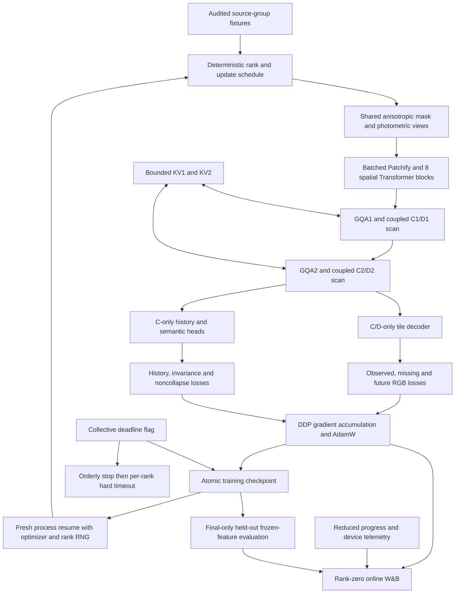

# Hybrid trainer and recovery architecture

The [model architecture](mavt-hybrid-v2.html) and C/D+KV state contract remain
the reference. This diagram adds the batch and training runtime around them.

Spatial batching keeps attention isolated between examples. Selective BF16
applies to spatial compute; FP32 evidence enters the original temporal pipeline.
Each source keeps its camera calibration when decoding, even when multiple
sources share a spatial batch. C/D are the recurrent scene variables; KV is
explicit additional memory. Optimizer/RNG/checkpoint data belong to training
recovery and are not added to the inference scene-state contract.

See the [frozen pilot protocol](../hybrid_synthetic_pilot_v2.md) for budgets,
losses, controls and the boundary between this pilot and paper benchmarks.
