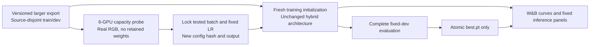

# Larger natural-video run and batch capacity calibration

This is a fresh run on a separately exported, source-disjoint natural-video
dataset. Existing trial outputs, checkpoints, manifests and configurations stay
unchanged. The CLI exposes `--steps`, `--global-clips`, `--microbatch`,
`--dev-every`, `--image-every` and `--log-every`; the scientific configuration,
including global clips and all reporting cadences, is fingerprinted in the new
immutable run lock. Learning rate remains 3e-4. A different effective batch is a
different optimization experiment, not a matched-budget comparison.

The new dataset run starts **fresh**, without resuming the old trial or probe
weights. Patchify, spatial Transformer, two C/D+KV stages, state budget, decoder
structure and loss definitions remain unchanged. Endpoint batching changes
execution packing only, with output and gradient parity checked below.

The six-GPU capacity probe cycles an audited real training clip per rank solely
to measure actual forward/backward/update work. Those repetitions never become
an enlarged dataset or a training checkpoint. Candidate per-GPU batches are
8, 32, 128, 256 and 512, in ascending order. Each candidate performs two complete
finite optimizer updates with spatial BF16 and the unchanged natural objective.
Local forward/backward completes before an all-rank failure check; gradients are
explicitly averaged across six ranks before the optimizer update. This is a
distributed correctness/capacity probe, not a DDP communication-overlap speed
benchmark. Its temporary trained weights are discarded.

All ranks must fit. Skip a candidate when observed previous peak memory predicts
more than 85% of locally available capacity, or measured duration predicts it
cannot finish before the calibration cutoff with a margin. Record per-rank peak
allocated/reserved memory, free/total memory, update time, global throughput and
failures. Choose the largest successfully tested batch within the 85% memory
limit and at least 90% of the best measured useful throughput. This reports the
largest stable **tested** batch, not a proof of the absolute hardware maximum.
The external job controller also enforces a hard cutoff.

The selected training configuration uses six times the per-GPU batch as its
global clip count and accumulation one, so the effective batch actually grows.
No artificial tensors are allocated just to fill VRAM. Batch size and LR are
frozen before the new run. Train to the configured step target or the absolute
optimization deadline, whichever arrives first. Keep only the checkpoint with
the lowest complete fixed-dev loss and upload that final selected artifact once.
Use short logging/image cadences so a deadline-limited run still yields curves
and fixed inference panels. Image cadence works independently of dev cadence.

To make large batches practical, endpoint image decoding is batched. The decoder
uses only relative query time. A temporary C/D readout translates each current
endpoint clock and query to zero; recurrent state clocks and all transition
timestamps are untouched. Non-endpoint queries retain the original per-stream
path. Tests compare outputs and C/D gradients against individual decoding at
different physical endpoint times, including a large timestamp. No action,
camera geometry or absolute timestamp supervision is invented.
