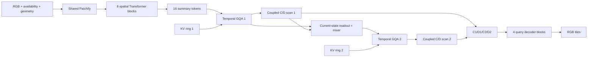

# MAVT hybrid v2 — thiết kế state C/D và KV cache hữu hạn

Cập nhật: **2026-10-17**. Trạng thái: **đã triển khai correctness reference, chưa train hybrid**.
Tài liệu mô tả implementation tại commit `20330de9afe278abee5694a2de65b1068ba95305` và các bước nghiên cứu tiếp theo.

[Architecture tương tác](../architecture/mavt-hybrid-v2.html) · [API reference](../reference_hybrid_cd_model.md) · [Preset JSON](../../configs/mavt4d/hybrid_cd2_kv_v2.json) · [Benchmark protocol](../benchmarks/mavt-hybrid-v2-protocol.md)

## 1. Bài toán và hai loại state

MAVT giữ unified visual tokenizer: ảnh, video và triplane đi qua shared Patchify.
Mục tiêu của C là giữ bằng chứng về diễn biến và cấu trúc của event; D giữ
configuration tương đối với lõi đó, không chỉ delta giữa hai frame. C có thể
giữ cả visual content cần tái tạo. Đây là mục tiêu học, không phải tính chất
được bảo đảm bởi tên tensor hoặc kiến trúc.

Thiết kế dùng spatial Transformer không có memory qua bước, sau đó hai tầng
temporal attention và coupled C/D scan. C/D là state recurrent trực tiếp của
các scan và là mã duy nhất decoder được đọc. Attention có KV cache riêng,
vì vậy C/D không phải toàn bộ memory của pipeline.

\[
z_t=(C_t^{(1)},D_t^{(1)},C_t^{(2)},D_t^{(2)}),
\qquad
S_t=(z_t,K_t^{(1)},V_t^{(1)},K_t^{(2)},V_t^{(2)},m_t).
\]

`CDCode` chứa `z_t` và timestamp để readout. `HybridCDKVState` chứa toàn bộ
`S_t` để tiếp tục stream chính xác; `m_t` là clock, IDs, validity và ring cursors.
Giữ cùng C/D nhưng thay KV có thể làm các lần cập nhật tiếp theo khác nhau.
Decoder ở thời điểm hiện tại vẫn phải cho cùng kết quả khi C/D và query không đổi.

Hybrid lấy cảm hứng từ phối hợp attention/SSM, nhưng không phải stock Jamba,
không có MoE và không mặc định dùng kernel Mamba. Coupled 2×2 cell và decoder
dưới đây là lựa chọn riêng của MAVT.

## 2. Pipeline và preset



Mỗi ring lưu K/V từ **input đã normalize của attention tương ứng**, không lưu
output của chính attention trở lại làm một recurrence ẩn trong layer.

| Thành phần | Preset mặc định |
|---|---|
| Bước video | Hai frame; state khả dụng tại timestamp frame cuối của bước |
| Spatial input tham chiếu | 256×256, một camera view |
| Shared Patchify | Conv3d kernel/stride 2×16×16, output width 384 |
| Spatial Transformer | 8 blocks, width 384, 6 heads, FFN 1536 |
| Spatial attention | Blocks 4/8 global trong bước; còn lại window 8×8, shift 0/4 luân phiên, không cyclic wrap |
| Pooling | 16 learned queries cố định → width 256; cross-attention 8 heads + FFN 1024 |
| Temporal stages | Hai stage, mỗi stage gồm một GQA block và một coupled C/D scan |
| GQA | Width 256, 8 query heads, 2 KV heads, head dimension 32, FFN 1024 |
| Temporal window | 16 accepted logical steps, gồm bước hiện tại; 16 tokens mỗi bước |
| KV lưu qua bước | BF16, ring cấp phát đủ 16 bước cho từng stage |
| C/D mỗi stage | C32×32 và D32×32, FP32 |
| Tổng C/D | 4096 FP32 values = 16384 byte |
| Mixer giữa stage | 16 queries đọc 64 C/D tokens stage 1; width 256, 8 heads, FFN 1024 |
| Decoder | 4 query blocks, width 256, 8 heads, FFN 1024 |
| RGB output | Tile 8×8; linear 256→192 không bias |
| D decoder bottleneck | Flatten 2048 values → 128 → 16; bounded modulation |
| Dropout / stochastic depth | 0 |
| Direct intra-cell D→C | Bật; `feedback` là một phần của config fingerprint |

16 summary tokens cung cấp 4096 evidence values mỗi bước. Đây là lựa chọn
ngân sách ban đầu, chưa phải bằng chứng đủ cho rate–distortion trên video tự nhiên.
Tăng spatial backbone không tăng causal state; tăng số summary tokens tăng KV
tuyến tính và đổi config/hash. `HybridConfig.tiny()` chỉ dành cho correctness tests.

## 3. Patchify và spatial backbone

Availability được áp **trước** Patchify; hidden RGB, kể cả NaN, không được ảnh
hưởng feature hoặc gradient. Coverage tách riêng để phân biệt thiếu dữ liệu với
pixel đen. Observed NaN bị từ chối. Padding của patch/window mang validity và
không được coi là quan sát.

Một view 256×256 cho lưới 16×16 patch tokens mỗi tubelet. Local windows không
vượt view hoặc nối hai cạnh ảnh qua cyclic shift. Hai global blocks chỉ trao đổi
patch/view trong cùng bước vật lý. Không có temporal attention hoặc cache trong
spatial backbone; normalization theo token, không dùng thống kê toàn clip.

Video dùng tối đa hai frame đã tới; ảnh đơn dùng một frame thật và validity
padding nội bộ. Triplane dùng shared projection với plane identity, không gán
ba plane thành ba thời điểm. Chia chunk không được đổi cách ghép tubelet:
state ở cuối tubelet causal, nhưng không có claim causal ở giữa hai frame.

Camera có row-index embedding ngay cả khi có calibration. Giữ thứ tự camera
ổn định qua stream và dùng cùng indices ở `DecoderQuery.view_ids`. Camera ID
không thay thế pose; calibration là input riêng. Triplane dùng plane embeddings
riêng. Không cấp geometry/visibility từ target chưa quan sát cho encoder.

Learned-query pooling không query bằng state cũ. Có ít nhất một patch khả dụng
thì 16 summary tokens hợp lệ; nếu toàn bước thiếu, bỏ qua observation encoder
thay vì tạo token quan sát từ padding. Encoder, pooling và MLP không giữ hidden
memory. Chất lượng ở video một view không tự chứng minh chất lượng mọi modality.

## 4. Hai temporal stages và parallel scan

Với evidence \(e_t\in\mathbb R^{16\times256}\):

\[
u_t^{(1)}=\operatorname{GQA}_1(e_{t-15:t}),
\qquad s_t^{(1)}=A_t^{(1)}s_{t-1}^{(1)}+b_t^{(1)}.
\]

32 paired write queries cố định đọc `u1` bằng cross-attention. Mỗi context width
256 đi qua MLP 256→256→(32×7), tạo cho mỗi tọa độ C/D: bốn matrix entries, hai
write values và một gate. Coefficients cũng nhận elapsed-time embedding, nhưng
không đọc state cũ của chính stage.

\[
r_t=\operatorname{Mixer}(u_t^{(1)},C_t^{(1)},D_t^{(1)}),
\qquad
u_t^{(2)}=\operatorname{GQA}_2(r_{t-15:t}),
\qquad
s_t^{(2)}=A_t^{(2)}s_{t-1}^{(2)}+b_t^{(2)}.
\]

Mixer dùng `u1` làm query đọc C/D hiện tại của stage 1 sau projection 32→256,
thêm residual và FFN. Mixer read-only: không ghi normalization/MLP output ngược
vào carry stage 1. K/V2 lấy từ `r` trước GQA2. Stage 2 được điều kiện hóa phi
tuyến bởi stage 1, nhưng không có stage 2→stage 1 feedback.

Thứ tự full-sequence là: spatial encoder → GQA1 causal → scan1 → mixer → GQA2
causal → scan2. Từng scan dùng phép hợp affine associative:

\[
(A_2,b_2)\circ(A_1,b_1)=(A_2A_1,A_2b_1+b_2).
\]

Đây là scan **theo layer**, không phải một scan duy nhất cho toàn joint state S.
Gates phụ thuộc carry trước của chính layer hoặc normalization trên đường carry
sẽ phá giả thiết này và cần cell/contract mới.

Temporal attention causal theo bước: 16 slots cùng bước nhìn nhau, query t chỉ
đọc accepted steps t−15…t. Không áp một thứ tự autoregressive tùy ý giữa summary
slots. Current và historical K/V đều được làm tròn BF16 **trước khi dùng** ở cả
sequence và step execution; CPU reference tính attention trên các giá trị đã
làm tròn, chuyển lại FP32 để tính toán.

Reference thực hiện affine prefix scan thật. Tuy nhiên attention dùng Python
window gathers và tìm candidate IDs qua sequence; không phải kernel linear-time
tối ưu. API trả T complete snapshots giữ T outputs. Một continuation state riêng
có budget cố định; không gọi toàn bộ full-sequence memory là hằng theo T.

## 5. C/D update trực tiếp và norm bound

Mỗi stage có 1024 block 2×2:

\[
\begin{bmatrix}c_t\\d_t\end{bmatrix}
=\begin{bmatrix}a_{CC}&a_{CD}\\a_{DC}&a_{DD}\end{bmatrix}_t
\begin{bmatrix}c_{t-1}\\d_{t-1}\end{bmatrix}
+\begin{bmatrix}b_C\\b_D\end{bmatrix}_t.
\]

`a_CD` cho D trước→C mới; `a_DC` cho C trước→D mới. Raw affine output FP32
được lưu trực tiếp, không qua VAE/quantizer/MLP sau update trên đường carry.

Đặt \(\operatorname{cut}(M)\) bằng M với entry CD bằng zero và:

\[
\rho(M)=\max(1,\|M\|_2,\|\operatorname{cut}(M)\|_2),\quad
N_f(M)=\begin{cases}M/\rho(M)&f=\mathrm{on}\\
\operatorname{cut}(M)/\rho(M)&f=\mathrm{off}.\end{cases}
\]

Với quan sát, implementation dùng:

\[
M=I+0.1\tanh(M_{raw}),\quad \alpha=\sigma(g),\quad
A=(1-\alpha)I+\alpha N_f(M),\quad b=\alpha\tanh(b_{raw}).
\]

Gate bias khởi tạo gần α=0.01. Normalizer xét cả full và cut operator, vì vậy
feedback ablation chỉ đổi entry CD, không âm thầm rescale các entries còn lại.
Bound áp lên toàn block, không chỉ diagonal. Nó giới hạn khuếch đại carry;
không tự chứng minh khả năng nhớ dài hoặc tổng state luôn bị chặn khi cộng b.

Khi toàn bước thiếu:

\[
G=-LL^\top+\omega J,\quad
J=\begin{bmatrix}0&-1\\1&0\end{bmatrix},\quad
A_{miss}=N_f(\exp(\Delta t\,G)),\quad b_{miss}=0.
\]

Đây là missing branch của cùng cell, không thêm predictor state riêng. Công thức
bao gồm common full/cut normalization đúng implementation. Δt=0 cho identity.
Autonomous rollout từng stage còn affine; chưa phải general nonlinear dynamics.

## 6. KV ring, timestamp và missing observations

Mỗi stage lưu K/V `[B,16,16,2,32]` BF16. Ring cấp phát đủ ngay từ đầu; snapshot
phải detached, compact, không giữ backing storage của clip dài hoặc autograd graph.
Sau step t, ring chứa tối đa 16 accepted steps gồm t. Lần attention kế tiếp chỉ
đọc 15 bước trước + hiện tại, không vô tình dùng window 17.

`slot_step_ids` quyết định thứ tự logic; ring position chỉ là storage. Cache
window tính bằng số bước, không phải giây. `last_time`/`slot_times` FP64 giữ thời
gian thật, attention có elapsed-time bias theo `log1p(max(0,t_query−t_key))`.
Không cần thêm RoPE history hoặc một positional cache ngoài contract.

| Tình huống | C/D update | Cache và clock |
|---|---|---|
| Có quan sát, Δt>0 | Observed affine update | Ghi K/V hợp lệ; accepted step mới |
| Có quan sát, Δt=0 | Assimilation bổ sung hợp lệ | Accepted step mới dù timestamp bằng nhau |
| Toàn bước thiếu, Δt>0 | Missing operator, b=0 | Age một slot; ghi zero K/V, validity=false; cập nhật clock |
| Toàn bước thiếu, Δt=0 | Identity | No-op toàn payload, không tăng cursor/count |
| Timestamp lùi | Từ chối | Không tiếp tục stream |

Missing steps chiếm logical slots; không kéo quan sát cũ hơn vào bù. Toàn bước
thiếu bypass encoder, GQA và mixer cho stream đó: không dùng cache cũ để ghi lại
evidence. Partial availability vẫn là observed step, nhưng hidden pixels không
vào KV. Summary2 chứa state1 readout chỉ được ghi KV hợp lệ khi có evidence thật.

Một missing step có Δt lớn chỉ age một slot. Caller phải cung cấp cùng lịch bước
khi so full/chunk/step/rollout; một khoảng thời gian lớn không thay thế nhiều
bước nhỏ trong cache semantics. Không reset ở chunk boundary hoặc dùng oracle
event-boundary labels lúc inference. TBPTT detach đồng thời C/D và KV nhưng giữ
giá trị; gradient sau detach không được coi là cùng full-BPTT gradient.

## 7. State contract v2 và byte accounting

Schema fingerprint là `mavt-hybrid-cd2-kv-v2`, payload schema version 2.
Không đổi nghĩa `CDState` v1. Hai tensor C/D đều có shape `[B,2,32,32]`;
K/V đều `[B,2,16,16,2,32]`.

| Tensor mỗi stream | Shape không gồm B | Dtype | Byte |
|---|---:|---|---:|
| C | 2×32×32 | FP32 | 8192 |
| D | 2×32×32 | FP32 | 8192 |
| K | 2×16×16×2×32 | BF16 | 65536 |
| V | 2×16×16×2×32 | BF16 | 65536 |
| last_time | scalar | FP64 | 8 |
| step_count | scalar | int64 | 8 |
| write_index | scalar | int64 | 8 |
| steps_filled | scalar | int64 | 8 |
| slot_times | 16 | FP64 | 128 |
| slot_step_ids | 16 | int64 | 128 |
| token_valid | 2×16×16 | bool | 512 |
| **Tổng** | | | **148256** |

C/D chiếm 16 KiB, KV 128 KiB, metadata 800 byte. Numeric header chung gồm version
int32 + config SHA-256 uint8[32] + weights SHA-256 uint8[32] = 68 byte. B streams
cần `B*148256+68` numeric payload bytes; B=1 là 148324 byte. `CDCode` có 16384
byte C/D và timestamp 8 byte mỗi stream, chỉ là ngân sách readout.

Whitelist payload là `c`, `d`, `k`, `v`, `last_time`, `step_count`, `write_index`,
`steps_filled`, `slot_times`, `slot_step_ids`, `token_valid`, `schema_version`,
`config_sha256`, `weights_sha256`. Kiểm exact fields, shape, dtype, finite values,
hash và ring consistency trước restart. Không synthesize missing cache cho
CD-only payload. Config hash bao gồm `feedback`; weights hash gồm tên, shape,
dtype và bytes của complete model state dictionary.

Cache rỗng vẫn tính toàn capacity, đồng thời báo occupancy. Serialization file
overhead, allocator overhead, model weights, attention workspace và training
autograd graphs được tính riêng. Không giữ raw-frame buffer, conv cache, patch
history, logits hoặc last-camera object ngoài contract. Thêm persistent memory
phải version contract và tính lại budget. Training resume còn cần optimizer,
scheduler và RNG checkpoint riêng; inference restart không cần chúng.

## 8. Decoder chỉ đọc C/D

Decoder đọc 64 C tokens của hai stage. Keys có stage/bank embeddings để routing;
values chỉ là bias-free linear của raw C, không learned embedding, affine offset
hoặc constant content residual. D flatten 2048→128→16→tanh tạo modulation chung.

Mỗi block có query FFN và 8-head cross-attention. D tạo query offset
`0.1*tanh(Wq*d)` và gain `1+0.1*tanh(Wg*d)`, tương ứng trong ±0.1 và [0.9,1.1].
Query residual phục vụ routing; RGB cuối chỉ lấy C-value aggregate cuối:

```text
weighted_sum(Linear(raw_C, bias=False))
  -> attention output projection, bias=False
  -> bounded D gain
  -> Linear(256,192,bias=False)
  -> RGB tile 3×8×8
```

Do đó C=0→RGB=0 chính xác, độc lập D. Không có KV/patch/image skip, D→RGB residual,
hoặc query embedding→RGB content bypass. Đây là inductive bias chống D gánh toàn
bộ nội dung qua một nhánh trực tiếp; không chứng minh D không giữ thông tin qua
routing. Phải kiểm bằng probes và interventions trong protocol.

Tile 8×8 không overlap; channel `c*64+dy*8+dx` của tile cột i/hàng j ánh xạ pixel
`(x=8*i+dx,y=8*j+dy)`. Tile list row-major, 256×256 cần 1024 query tokens. H/W
không chia hết 8 thì ceil grid rồi crop biên. Padding không có reconstruction loss.

Không self-attention giữa queries; query chunking phải giữ output. Arbitrary
`image_pixel` query tính aligned tile rồi chọn containing pixel bằng floor,
kể cả subpixel coordinates. Không có persistent decoder cache. Output adapters
cho world XYZ hoặc triplane UV chưa triển khai; input modality support không
đồng nghĩa đã có mọi output coordinate adapter.

Query timestamp không tự update state. Muốn đọc tương lai phải rollout toàn S
theo lịch missing steps rồi decode C/D tương ứng. Pixel của vật che tự nhiên vẫn
là observed RGB: availability không phải GT mask của vật nằm sau. Đọc amodal hoặc
depth-layer cần query/target riêng, chưa nằm trong RGB tile decoder này.

## 9. Kiểm chứng và phạm vi còn lại

Tại revision trên: **83 hybrid tests và 576 CPU regression tests qua**. Gate
hybrid gồm fresh-process restart trước/sau cache wrap, causal prefix perturbation,
raw-RGB full/chunk/step/associative parity, temporal gradient parity, BF16 read,
hidden-NaN isolation, no-op/missing, compact storage, config/weights identity và
decoder C-only content. Ba optimizer-containing tests được bỏ khỏi regression
để không chạy train. Server-data tests và phần tokenizer ngoài phạm vi regression
này không được suy là đã kiểm.

Default-width preset đã forward/decode với spatial grid nhỏ 17×33 để kiểm shape,
blocks và budget. Đây không phải throughput measurement ở 256×256. Observed Δt=0
được API cho phép nhưng chưa có execution regression riêng cho trường hợp đó.
Chi tiết gates, tolerances và giới hạn nằm trong [protocol](../benchmarks/mavt-hybrid-v2-protocol.md).

| Hạng mục | Trạng thái / bước tiếp theo |
|---|---|
| Contract v2, reference modules, JSON preset | Đã triển khai và kiểm correctness CPU |
| C giữ lịch sử, D giữ configuration | Chưa có kết quả học hybrid |
| Hybrid long-lag/flush fixtures | Cần artifact version mới và input/target audits |
| Hybrid loss, seeds, train budget, selection | Chưa khóa; phải freeze trước mọi learning run |
| Hybrid trainer/evaluator | Chưa tích hợp; runner synthetic v1 không tự chạy hybrid |
| CUDA, optimized attention/scan, memory/throughput | Chưa đo |
| Natural video và amodal/geometry readout | Cần protocol/data/output adapters tương ứng |

Giữ baseline/reference/pilot v1 nguyên nghĩa. Bước tiếp theo là hoàn thành các
gate protocol hybrid, không suy kết quả learning từ việc 83 technical tests qua.
Generic associative scan không tự bảo đảm nhanh hơn GRU; chỉ claim lợi ích tốc
độ sau khi đo toàn pipeline, và lợi ích biểu diễn sau khi kiểm held-out controls.

## 10. Cơ sở tham khảo

- [Mamba](https://arxiv.org/abs/2312.00752): input-dependent selective recurrence và hardware-aware scan.
- [Jamba](https://arxiv.org/abs/2403.19887): kết hợp Transformer/Mamba; MAVT không dùng MoE hoặc mặc định thừa hưởng throughput của mô hình đó.
- [Mamba-2 / SSD](https://arxiv.org/abs/2405.21060): cơ sở tham khảo cho cấu trúc SSM và thuật toán; không chứng minh có sẵn kernel tối ưu cho coupled 2×2 cell ở đây.

Kích thước, cache policy, decoder constraints và benchmark interventions trong
tài liệu là các quyết định MAVT, không phải kết luận thực nghiệm từ các bài trên.
